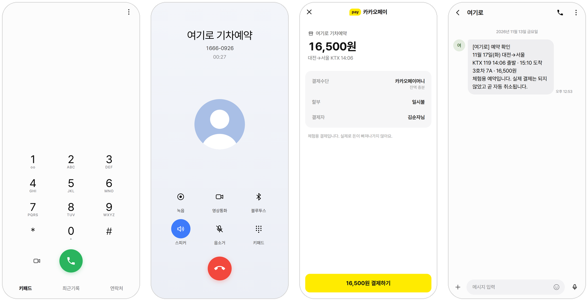
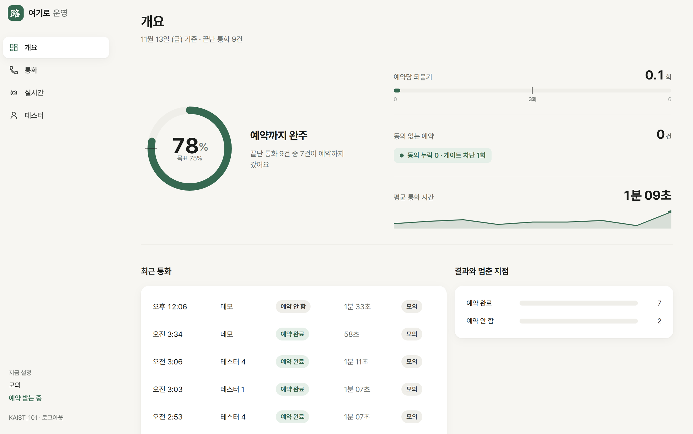
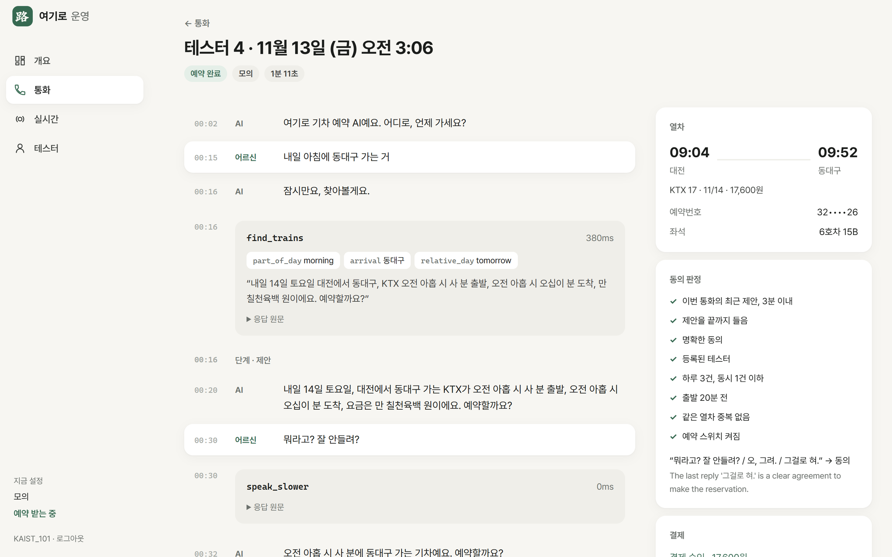
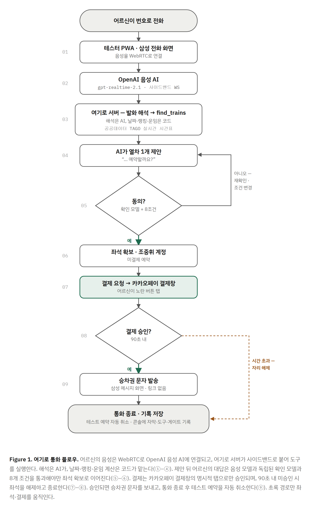
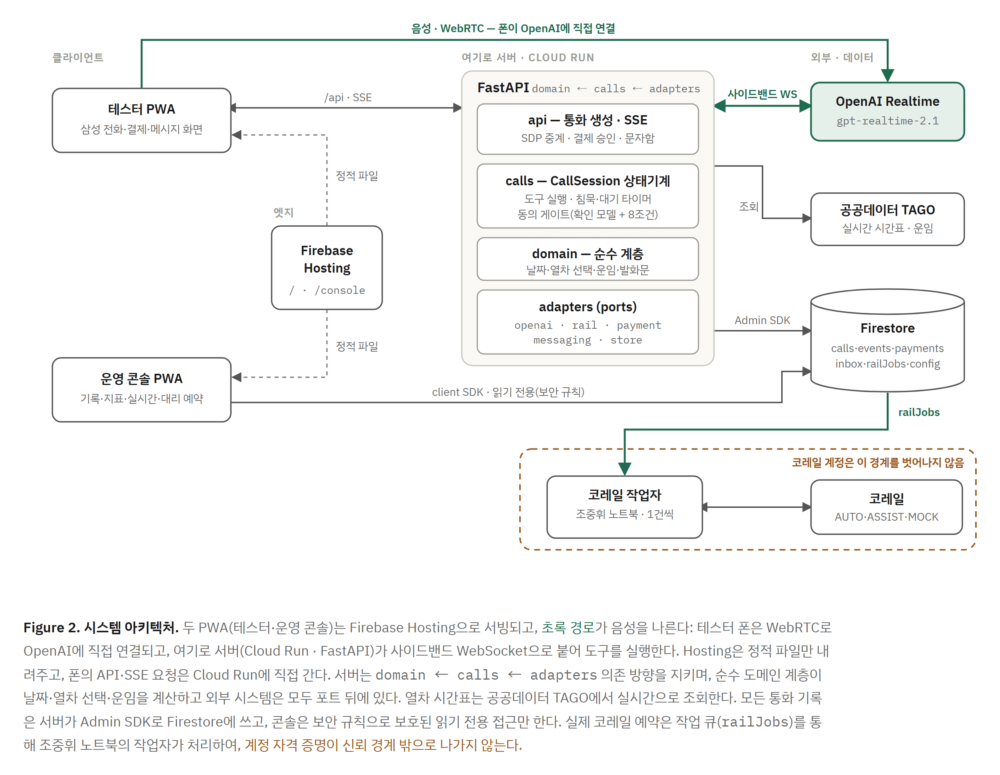

<p align="center">
  
</p>

<h1 align="center">여기로</h1>

<p align="center">전화 한 통으로 끝나는 기차 예매</p>

<p align="center">
  <picture>
    <source media="(prefers-color-scheme: dark)" srcset="docs/screens/hero-dark.png">
    
  </picture>
</p>

이번 프로토타입은 전화 한 통으로 기차표를 예매하는 흐름과, 어르신도 쉽게 따라올 수 있는 음성 AI 상담 경험을 보여 드리는 데 초점을 맞췄습니다. 실제 전화번호 연결과 결제 연동은 코레일과의 계약이 필요해서 다음 단계 과제로 남겨 두었습니다.

폰에서 **[yeogiro-kaist.web.app](https://yeogiro-kaist.web.app)** 을 열면 바로 걸어 볼 수 있습니다. 카카오톡에서 열면 기본 브라우저로 넘어갑니다.

## 어떻게 동작하나요

1. 여기로 앱의 모의 전화 화면에서 번호를 누르고 전화를 겁니다
2. AI 상담원이 받아 어디로, 언제 가시는지 짧게 여쭙습니다
3. 공공데이터 열차 API를 조회해 가장 알맞은 열차를 한 번에 읽어 드립니다
4. "응", "그걸로 혀" 같은 대답을 동의 판정 모델이 한 번 더 확인한 뒤에만 좌석을 잡습니다
5. 모의 카카오페이 결제창에서 결제하면 예약 확인 문자가 도착합니다

열차 시간표와 운임은 실제 정보이고, 예약 번호와 결제는 모의로 처리합니다. 운영자는 콘솔에서 통화마다 대화, 도구 호출, 동의 판정을 그대로 다시 볼 수 있습니다.

<p align="center">
  
</p>

<p align="center">
  
</p>

<p align="center">
  
</p>

## 무엇이 진짜인가요

| 진짜 | 모의 |
| --- | --- |
| OpenAI 음성 대화와 도구 호출 | 전화망 (앱이 삼성 전화 화면을 재현하고 음성은 WebRTC) |
| 공공데이터 TAGO 열차 시간표와 운임 | 좌석 예약 번호 |
| 동의 판정, 결제 요청 흐름, 통화 기록 | 결제 승인 (돈은 움직이지 않음) |
| | 문자 (앱 안의 삼성 메시지 화면) |

## 구성

| 폴더 | 하는 일 |
| --- | --- |
| `apps/phone` | 테스터 폰에 설치하는 PWA. 삼성 전화, 메시지, 결제 화면 |
| `apps/console` | 운영 콘솔 PWA. 통화 기록, 지표, 테스터 관리 |
| `packages/contracts` | 앱과 서버가 함께 쓰는 타입 |
| `server` | FastAPI 통화 서버, 대화 시뮬레이터, 코레일 작업자 |
| `infra/firebase` | Firestore 규칙과 인덱스 |
| `docs` | 기획안, 화면 캡처, 그림 |

<p align="center">
  
</p>

## 바로 실행

Node 20, Python 3.12 이상, OpenAI API 키가 있으면 됩니다.

```bash
cp .env.example .env            # OPENAI_API_KEY 입력

cd server
python -m venv .venv
.venv/Scripts/pip install -e ".[dev]"
STORE=memory .venv/Scripts/python -m uvicorn yeogiro.api.app:app --port 8787
```

새 터미널에서 웹 앱을 띄웁니다.

```bash
npm install
npm run dev:phone               # http://localhost:5199/t/demo
npm run dev:console             # http://localhost:5174/console/?demo=1
```

macOS나 Linux에서는 `.venv/Scripts` 대신 `.venv/bin` 을 씁니다.

## 검사

```bash
cd server
.venv/Scripts/ruff check src tests
.venv/Scripts/python -m mypy src
.venv/Scripts/python -m pytest
.venv/Scripts/python -m yeogiro.sim      # 시나리오 카드로 대화 검증, OpenAI 요금이 듭니다

cd ..
npm run typecheck && npm run build
```

## 더 보기

[환승 경로 검색: 설계·설정·제약](docs/transfer-search.md). 직통편을 우선 추천하고, 조건에 맞는 직통편이 없으면 실제 TAGO 시간표로 1회 환승 경로를 찾습니다. 시간표 조회는 좌석 재고 확인이 아니며, 환승 예약은 구간별 모의 예약만 지원합니다.

[기획안](docs/plan.md) · [화면 모음](docs/screens/README.md) · [배포와 운영](docs/operations.md)

## 기여

`main` 에는 직접 올리지 않습니다. 브랜치에서 작업해 PR을 열면 조중휘([joonghui0926](https://github.com/joonghui0926))가 리뷰하고 머지합니다. 자세한 규칙은 [CONTRIBUTING.md](CONTRIBUTING.md)에 있습니다.
